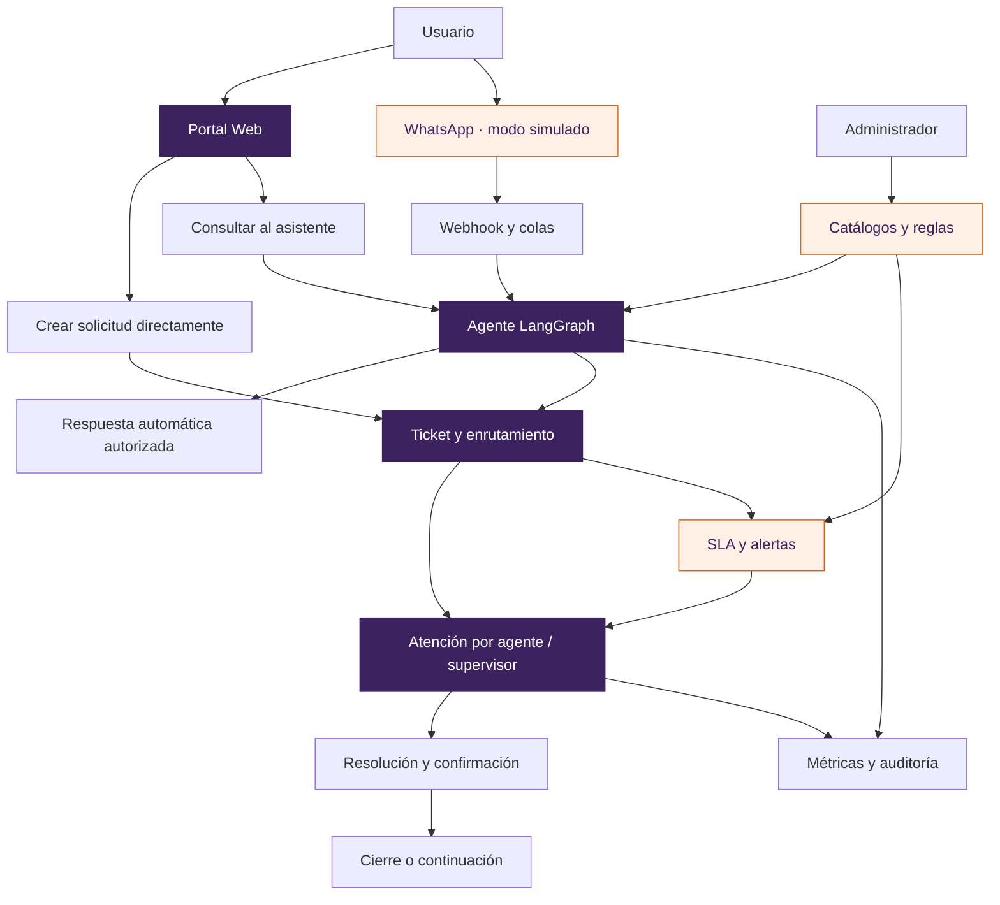

# Mapas visuales del MVP Mesa de Ayuda Omnicanal

Estos esquemas explican la funcionalidad implementada por **Claude (BACKEND)** y **ChatGPT (FRONTEND)**. Están contrastados con la SPEC v5.2 y el código de `main` en `9728620`, el 14 de octubre de 2026. GitHub representa los bloques Mermaid directamente al abrir los archivos.

| Esquema | Qué permite entender |
|---|---|
| [01 · Arquitectura y roles](esquemas/01-arquitectura-y-roles.md) | Canales, cinco apps Django, datos, permisos y navegación por rol. |
| [02 · Tickets, conversación y SLA](esquemas/02-tickets-conversacion-sla.md) | Creación, atención, las 17 transiciones, adjuntos y procesos periódicos. |
| [03 · Agente e integraciones](esquemas/03-agente-e-integraciones.md) | LangGraph, autonomía N0–N4, revisión humana, SGA y WhatsApp. |
| [04 · Administración, métricas y verificación](esquemas/04-administracion-metricas-verificacion.md) | Configuración, indicadores, controles transversales y recorrido de prueba. |
| [Grafo técnico generado](agent_graph.md) | Nodos y aristas exactos del agente; se regenera desde el código. |

## Vista del servicio completo

## Cómo leer los diagramas

- Las flechas representan flujo de información o pasos; no conceden permisos por sí mismas.
- Los rombos representan decisiones que toma el backend.
- Los estados y los textos identifican cada situación: el color es una ayuda adicional.
- Los diagramas funcionales simplifican el código; los contratos de `progress.md` y las validaciones del backend siguen siendo la fuente de verdad.

## Límites de esta entrega

| Integración | Qué existe | Qué exige una conexión real |
|---|---|---|
| Web | Pantallas FE-T01 a FE-T12 y operaciones Django. | Despliegue, configuración y validación con usuarios. |
| WhatsApp | Vinculación, webhook firmado, colas y simulador. | Configurar Meta, credenciales, webhook accesible y probar extremo a extremo. |
| Datos institucionales | `LocalProvider`, adaptador HTTP SGA y servidor simulado. | Confirmar el contrato del SGA real, credenciales y respuestas. |
| LLM | Proveedor `fake` y adaptador Qwen3/vLLM `openai_compat`. | Acceso a la red universitaria y medición con el servidor real. |

Una implementación o prueba con simuladores no acredita que un servicio externo esté conectado. La aprobación funcional del usuario se registra separadamente de los resultados automatizados.
