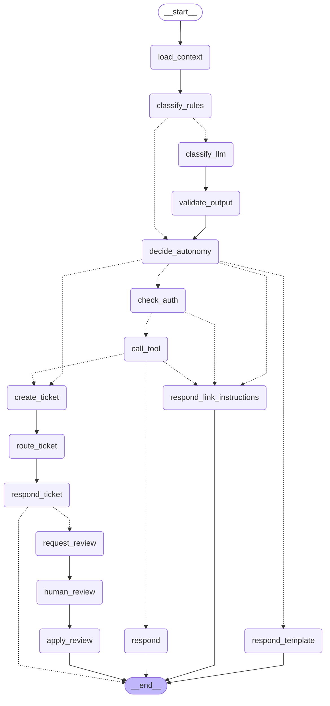

# Grafo del agente de atención (LangGraph)

Versión del grafo: **1.1.0** · generado con `python manage.py agent_graph` (no editar a mano).

Fuente: `apps/ai/agent/graph.py`. Las líneas punteadas son aristas condicionales.

