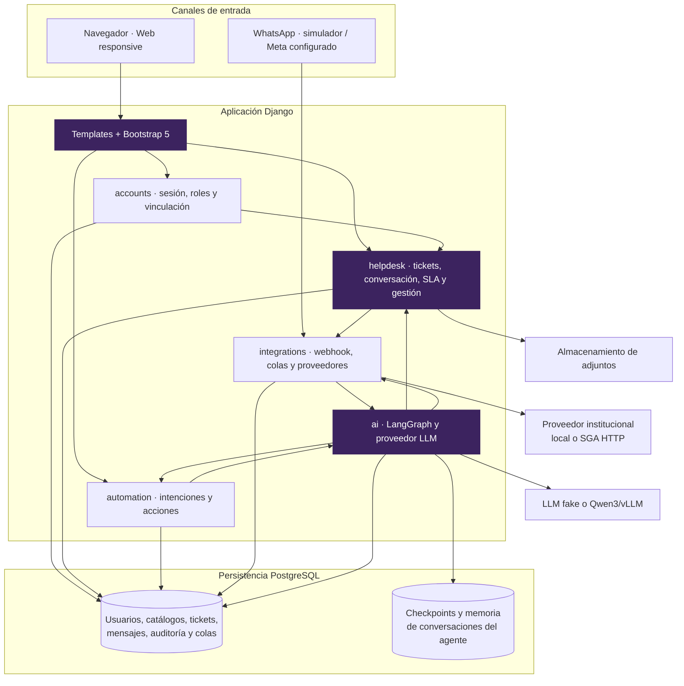
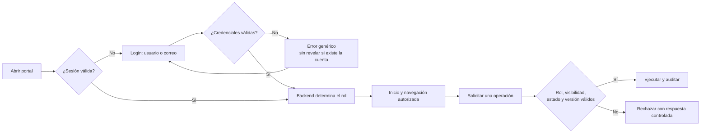
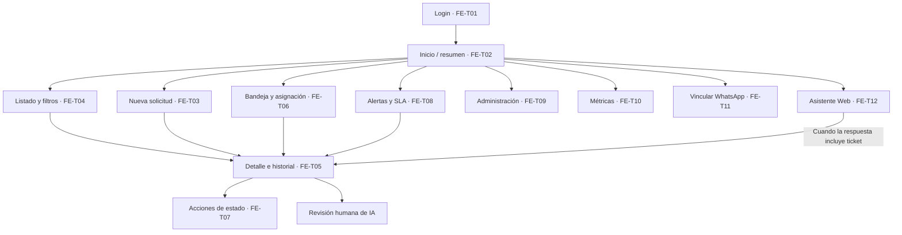

# 01 · Arquitectura, roles y pantallas

[Volver al índice](../README.md) · [Siguiente: tickets y SLA](02-tickets-conversacion-sla.md)

## 1. Arquitectura de la aplicación

El MVP es un **monolito modular Django** con cinco apps. El navegador recibe HTML mediante Django Templates, Bootstrap 5 y JavaScript mínimo. Las decisiones de negocio pertenecen al backend.

No hay SPA, WebSockets, GraphQL, Redis ni Celery. Los trabajos periódicos se ejecutan mediante comandos Django programados externamente.

## 2. Acceso y autorización

Ocultar un botón es presentación; cada solicitud vuelve a validarse en el servidor. La descarga y las operaciones sobre un ticket no visible devuelven 404 para evitar revelar su existencia. Otros fallos de permisos pueden devolver 403.

## 3. Matriz funcional por rol

| Rol | Universo de tickets visible | Operaciones principales |
|---|---|---|
| Usuario | Sus propios tickets. | Crear, responder, adjuntar, confirmar o rechazar resolución y reabrir dentro del plazo. |
| Agente | Propios, asignados a él, de sus áreas y sin área para triaje compartido. | Atender y ejecutar acciones/asignaciones que el backend autorice. |
| Supervisor | Todos. | Supervisar, asignar/reasignar, escalar, revisar decisiones humanas, alertas y métricas. |
| Administrador | Todos para consulta. | Gestionar catálogos/configuración. No opera transiciones por su rol de administrador. |

Los permisos concretos también dependen del ticket, del responsable y de su estado; esta matriz no reemplaza esas condiciones.

## 4. Mapa de pantallas

La navegación se muestra según el rol y los contratos aprobados; el mapa reúne todas las pantallas, no significa que un usuario tenga acceso a todas.

## 5. Ubicación de responsabilidades

| Capa | Responsabilidad | Fuente |
|---|---|---|
| FRONT | HTML, formularios ligados, mensajes, etiquetas, accesibilidad y responsive. | `templates/`, `static/` |
| BACK | Sesión, formularios, autorización, estados, SLA, prioridad y acciones disponibles. | `apps/`, `config/` |
| Coordinación | Contratos de URL/contexto/formulario, decisiones y estados de trabajo. | `progress.md` |

Fuentes de código: [rutas principales](../../config/urls.py), [visibilidad de tickets](../../apps/helpdesk/queries.py), [roles](../../apps/accounts/roles.py).
