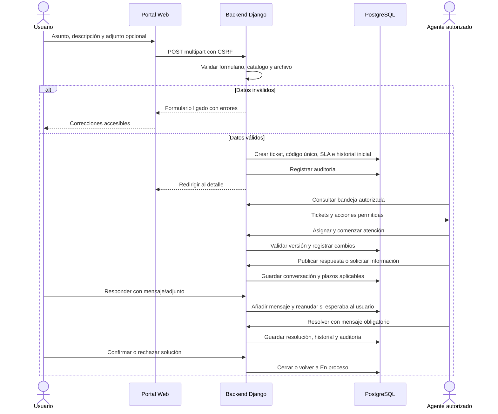
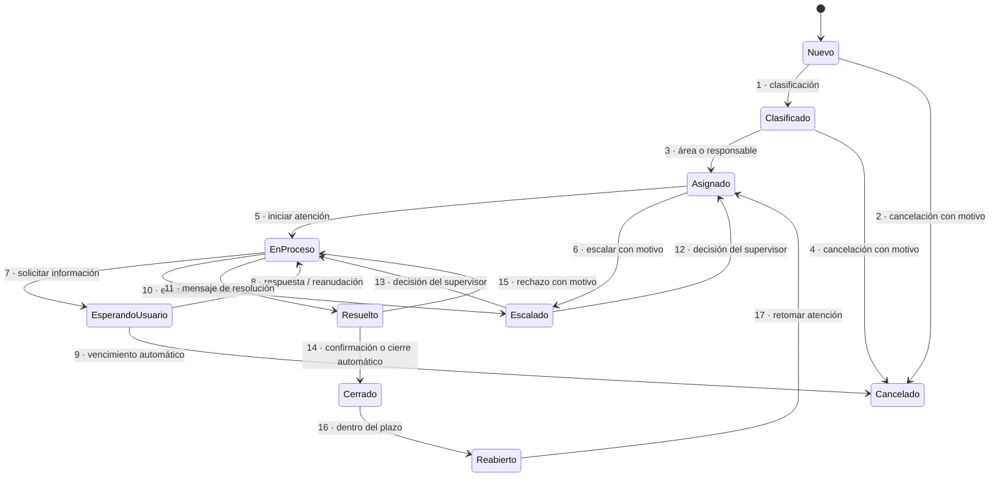
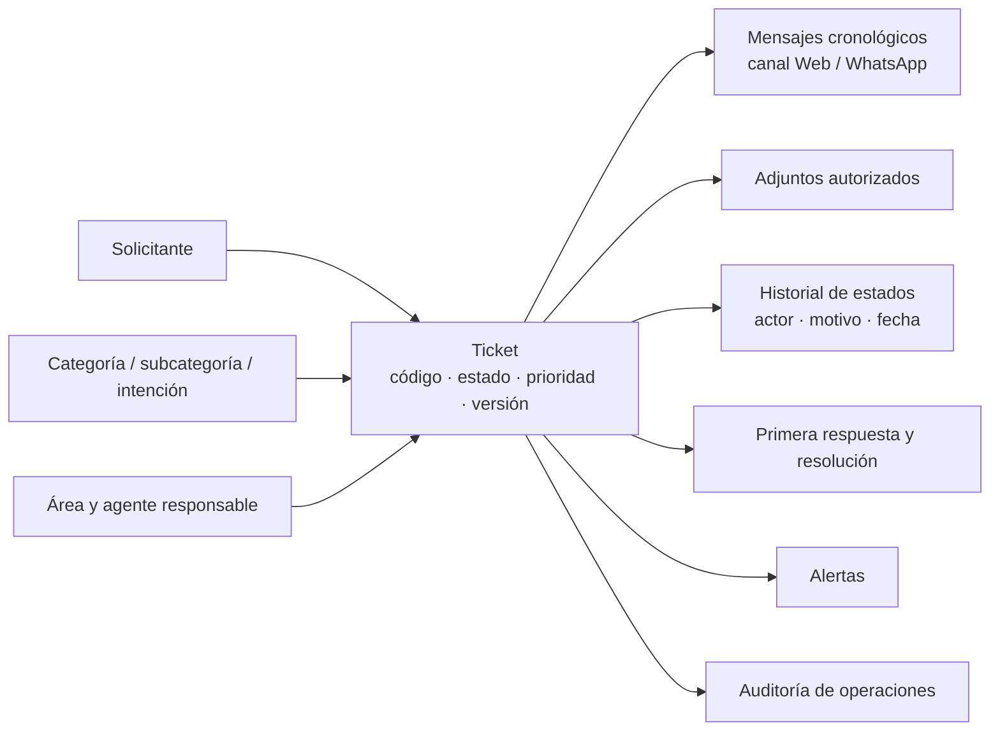
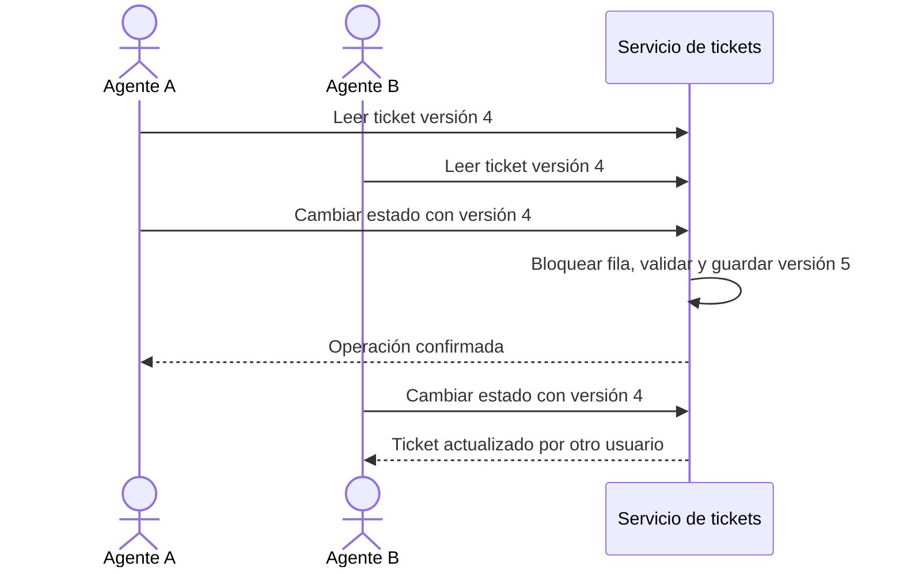
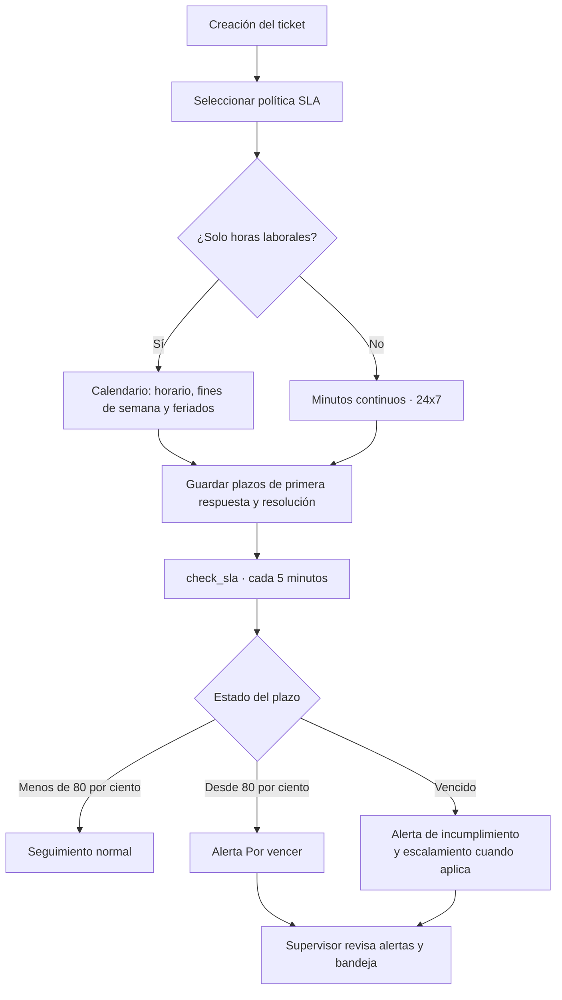

# 02 · Tickets, conversación y SLA

[Volver al índice](../README.md) · [Siguiente: agente e integraciones](03-agente-e-integraciones.md)

## 1. Recorrido de una solicitud

El código `HD-AAAA-NNNNNN` se genera con una secuencia PostgreSQL para evitar duplicados concurrentes. Estado, prioridad, plazos y área son datos del backend, no campos controlados libremente por el navegador.

## 2. Máquina de estados completa

| Transiciones | Actores habilitados, sujetos a visibilidad y condiciones |
|---|---|
| 1 y 3 | Sistema, Agente o Supervisor. |
| 2 y 4 | Dueño del ticket o Supervisor; motivo obligatorio. |
| 5 y 7 | Agente responsable o Supervisor. |
| 6 y 10 | Agente responsable, Supervisor o Sistema; motivo obligatorio. |
| 8 | Dueño, Agente o Supervisor. |
| 9 | Sistema. |
| 11 | Agente responsable o Supervisor; mensaje de resolución obligatorio. |
| 12 y 13 | Supervisor. |
| 14 | Dueño o Sistema. |
| 15 | Dueño; motivo obligatorio. |
| 16 | Dueño o Supervisor; dentro de la ventana configurada. |
| 17 | Sistema o Supervisor. |

Toda transición fuera de esta tabla se rechaza. Cancelado no tiene salida. Asignado exige área o responsable. El backend calcula las acciones visibles para cada usuario.

## 3. Información vinculada al ticket

Los mensajes internos se muestran únicamente según el contrato y la autorización del backend. Los adjuntos admitidos son PDF, PNG y JPG/JPEG hasta 5 MB: el servidor verifica extensión, tamaño y firma del contenido. La descarga comprueba visibilidad y pertenencia al ticket.

## 4. Protección frente a ediciones simultáneas

## 5. Control de SLA

| Prioridad | Primera respuesta inicial | Resolución inicial |
|---|---:|---:|
| Baja | 480 minutos | 4320 minutos |
| Media | 240 minutos | 2880 minutos |
| Alta | 60 minutos | 1440 minutos |
| Crítica | 15 minutos | 240 minutos |

Son valores iniciales configurables, no promesas expresadas en días naturales. El FRONT muestra las fechas y el estado SLA calculados por el servidor. La alerta abierta por tipo/ticket se controla para no duplicarse.

| Proceso programado | Frecuencia prevista | Finalidad |
|---|---|---|
| `process_integration_queue` | Cada minuto | Entradas/salidas WhatsApp y reintentos. |
| `check_sla` | Cada cinco minutos | Alertas de plazos y escalamiento aplicable. |
| `close_stale_tickets` | Cada hora | Cierre de resueltos y cancelación por espera vencida según configuración. |

Los comandos existen; para ejecución autónoma es necesario configurarlos en el despliegue.

Fuentes: [workflow](../../apps/helpdesk/workflow.py), [creación](../../apps/helpdesk/tickets.py), [SLA](../../apps/helpdesk/sla.py), [rutas](../../apps/helpdesk/urls.py).
