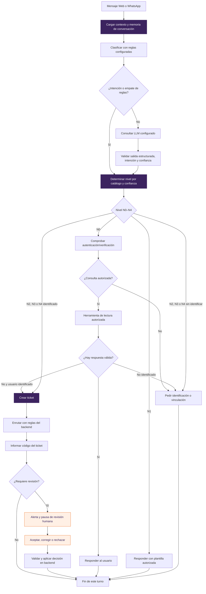
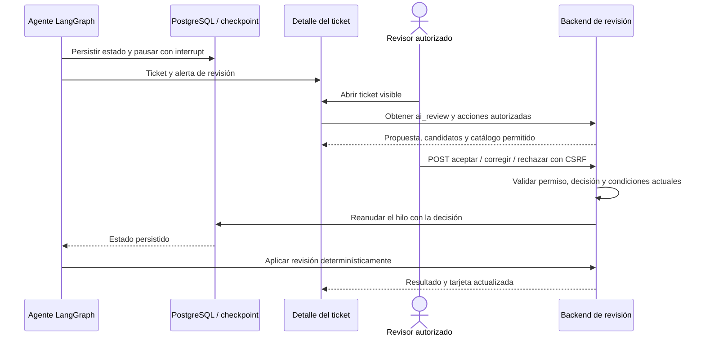
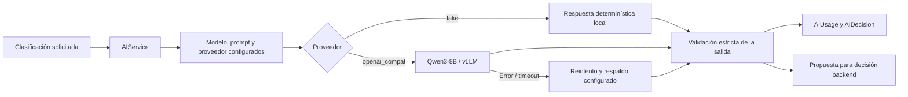
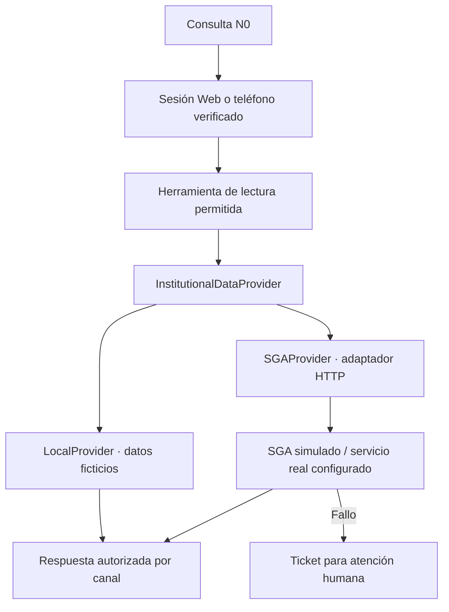
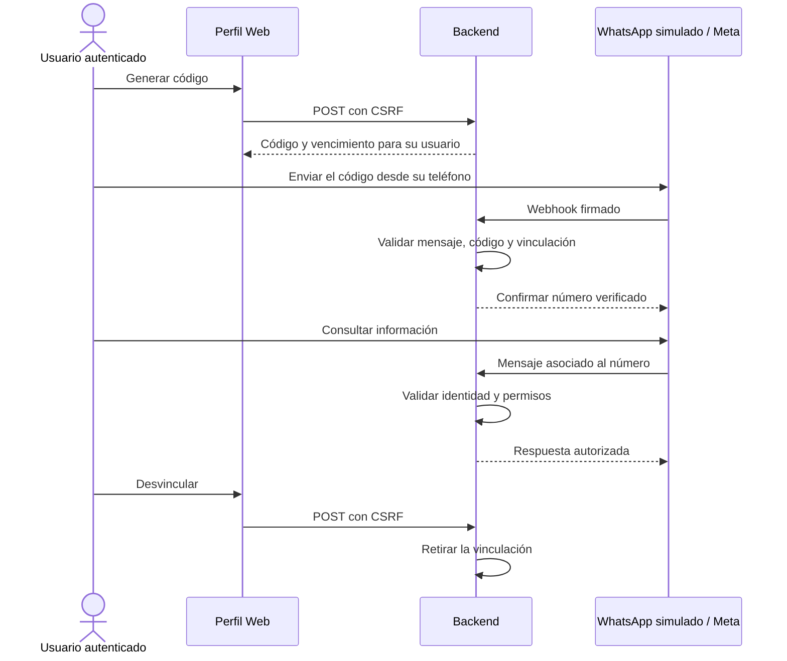
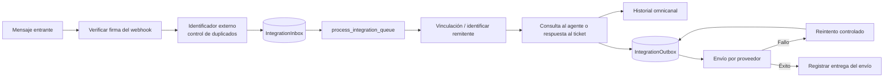

# 03 · Agente de atención e integraciones

[Volver al índice](../README.md) · [Siguiente: administración y verificación](04-administracion-metricas-verificacion.md)

## 1. Clasificación y autonomía

Este mapa agrupa los 16 nodos técnicos. El [grafo generado](../agent_graph.md) mantiene sus nombres y aristas exactas.

| Nivel | Fuente / operación | Resultado funcional |
|---|---|---|
| N0 · Consulta estructurada | Herramientas del proveedor institucional. | Horario, notas, deuda, matrícula, materias o consulta de estado autorizada. |
| N1 · Conocimiento autorizado | Plantilla activa configurada. | Información aprobada; no usa RAG ni inventa hechos. |
| N2 · Ticket + validación | Creación y reglas determinísticas. | Solicitud registrada para el proceso definido. |
| N3 · Ticket + routing | Creación y reglas de enrutamiento. | Solicitud destinada al área configurada. |
| N4 · Revisión humana | Caso ambiguo, desconocido o de baja confianza. | Ticket, alerta y decisión humana. |

La implementación envía a N4 cuando falta intención o la confianza es menor que 0,70. N2/N3 con confianza menor que 0,85 también solicitan revisión. Estos umbrales proceden del backend, no de la plantilla. Un empate de reglas se deriva a decisión humana; no se fuerza una elección por LLM.

## 2. Revisión humana con persistencia

La corrección se muestra solo cuando BACK entrega `can_correct`. La presencia de la tarjeta depende del contexto aprobado; el FRONT no calcula autonomía ni permite herramientas nuevas. El hilo del agente usa `Conversation.id` y checkpoints PostgreSQL para soportar memoria y reanudación.

## 3. LLM y protección de datos

Al clasificador se envían el mensaje, el catálogo y el prompt correspondiente; no se envían notas, deuda ni registros institucionales del usuario. El backend valida la respuesta antes de usarla. El LLM no ejecuta cambios de estado, asignaciones ni escrituras de negocio libremente.

El adaptador real existe, pero su conectividad y calidad deben medirse desde la red universitaria. Las pruebas con `fake` o un servidor HTTP simulado no equivalen a probar Qwen3 real. Los reintentos, el respaldo configurado y la derivación a ticket protegen la continuidad de la solicitud.

## 4. Datos institucionales

Métodos institucionales: `get_schedule`, `get_grades`, `get_debt`, `get_enrollment` y `get_subjects`. La consulta de estado de ticket también se ofrece como herramienta autorizada del sistema. No hay escritura de notas ni pagos mediante el agente.

## 5. Vinculación de WhatsApp

La pantalla muestra el código según el contrato de una sola vista, su vigencia y el estado de vinculación. Los datos personales requieren número verificado; la deuda por WhatsApp se minimiza al total. El modo simulado se señala explícitamente en la interfaz.

## 6. Canal WhatsApp y colas

El procesamiento evita repetir efectos de un mismo mensaje y separa recepción de envío. No usa WebSockets ni colas Redis/Celery. Para Meta real se necesitan configuración, credenciales, conectividad y pruebas; el MVP puede recorrerse con `whatsapp_simulate`.

Fuentes: [grafo](../../apps/ai/agent/graph.py), [autonomía](../../apps/automation/autonomy.py), [proveedor LLM](../../apps/ai/providers/openai_compat.py), [integraciones](../../apps/integrations/), [contratos](../../progress.md).
