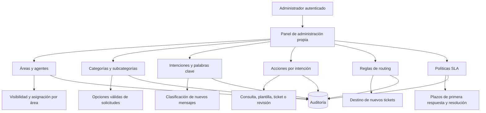
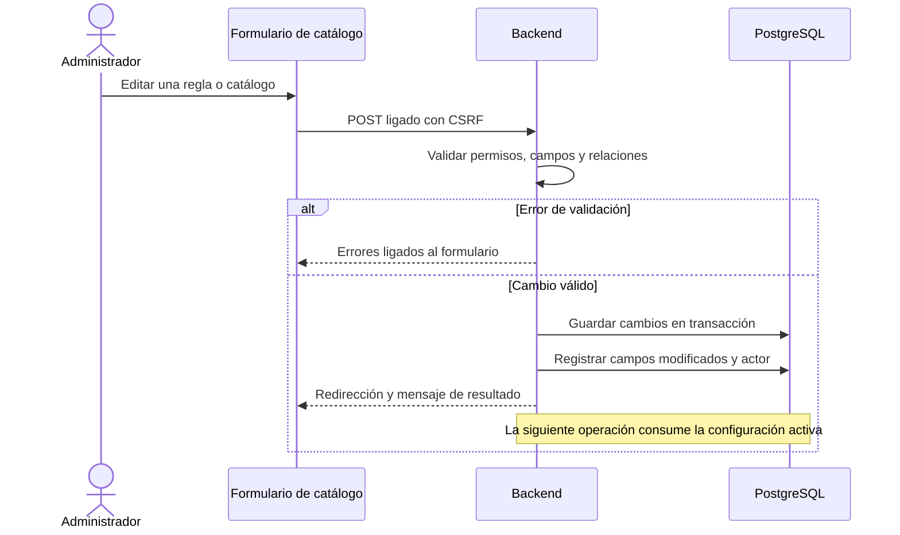
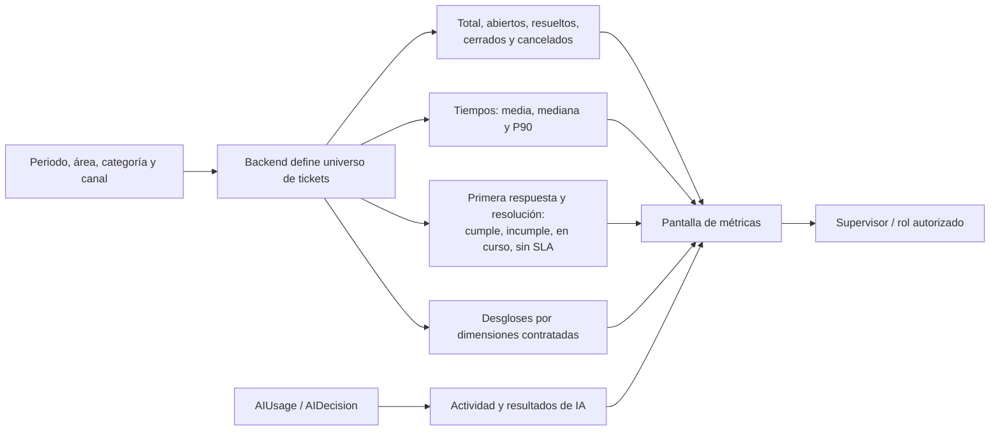
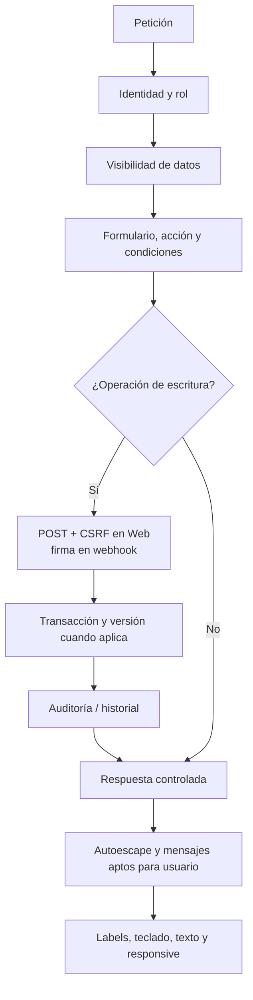
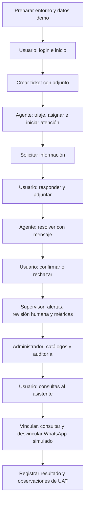
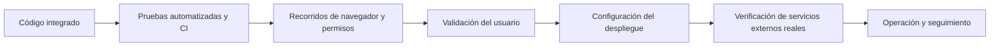

# 04 · Administración, métricas y verificación

[Volver al índice](../README.md)

## 1. Configuración de la atención

La administración propia ofrece siete catálogos: áreas, categorías, subcategorías, intenciones, acciones, reglas de routing y políticas SLA. Las operaciones incluyen crear, editar, filtrar, paginar y activar/desactivar. No se ofrece borrado físico de catálogos; los cambios se validan y auditan en el backend.

La gestión adicional de usuarios, permisos y modelos de IA corresponde a Django admin según sus permisos; no debe confundirse con los siete catálogos del panel propio.

## 2. De un cambio de configuración a una operación

## 3. Métricas operativas e IA

El periodo usa fechas locales y extremos incluidos. Los tiempos de estadísticas se expresan en minutos de reloj; no son la misma medida que los minutos laborales del SLA. El cumplimiento se calcula sobre casos decididos: `cumple / (cumple + incumple)`. Si no existen casos decididos se muestra ausencia de datos, no un cero inventado.

El FRONT no agrega ni calcula métricas. La extensión de métricas WhatsApp solicitada en `CONTRACT-FRONT-007` debe aprobarse/documentarse antes de mostrar variables adicionales; la existencia de cálculos backend no crea un contrato de presentación automáticamente. Consultar su estado vigente en `progress.md`.

## 4. Controles que atraviesan todos los módulos

También se aplican límites de intentos de login, validación de archivos, secretos por entorno y configuración de producción. El dibujo es una lista lógica de controles, no el orden exacto de cada middleware. Ningún control debe inferirse únicamente por el color o por ocultar un elemento visual.

## 5. Recorrido funcional para revisar el MVP

Usar una base de desarrollo aislada con `seed_demo`, según el [README del proyecto](../../README.md). El siguiente recorrido conecta los módulos sin utilizar datos reales.

| Verificación | Resultado esperado |
|---|---|
| Privacidad Usuario | No puede consultar ni descargar datos de tickets ajenos. |
| Áreas Agente | Solo ve su universo autorizado, incluida la cola compartida sin área. |
| Estados | No se ejecutan transiciones no permitidas; motivos y versión se validan. |
| Conversación | Mensajes ordenados con etiqueta de canal y adjuntos autorizados. |
| Revisión IA | Solo el revisor habilitado acepta/corrige/rechaza; el grafo se reanuda. |
| Asistente | Respuesta escapada, ejemplos y formulario operativos sin JavaScript. |
| WhatsApp | Código vigente, identificación correcta y modo simulado explícito. |
| Métricas | Filtros y errores ligados, cero distinguido de ausencia de datos. |
| Accesibilidad | Teclado, labels, errores, contraste y tablas utilizables en móvil. |
| Recuperación | Fallos de proveedor, duplicados y versiones antiguas se manejan sin repetir efectos. |

## 6. Condiciones de aceptación y despliegue

Las pruebas automatizadas no sustituyen UAT. Publicar un entorno Cloud no instala por sí mismo los comandos periódicos de la aplicación ni demuestra la primera ejecución de una automatización de seguimiento. La elección de tipografía oficial y las conexiones reales se validan aparte.

Fuentes: [administración](../../apps/helpdesk/manage_views.py), [métricas](../../apps/helpdesk/metrics.py), [seguridad y configuración](../../config/settings/), [registro de coordinación](../../progress.md).
